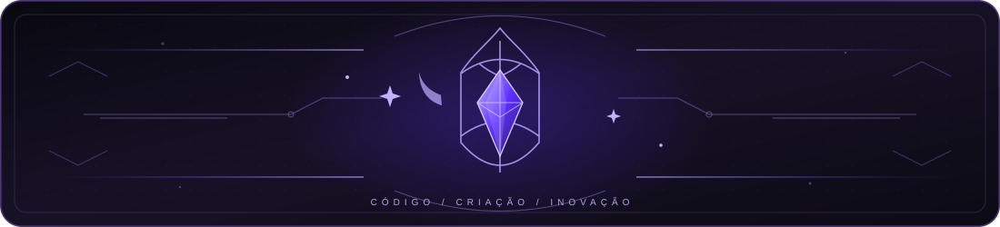
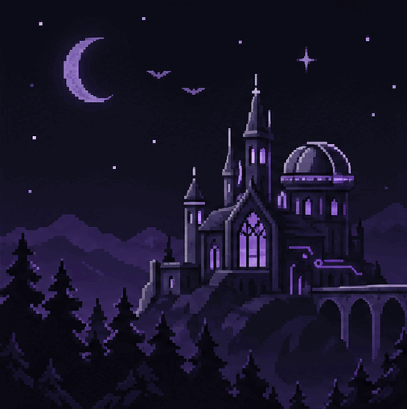

 

<strong>Desenvolvimento de soluções · Automação · Dados · Criatividade</strong>

 
 

Criatividade, lógica e aprendizado em constante evolução. ☾ ✧

☾ &nbsp; ✧ &nbsp; 🌒 &nbsp; ☆ &nbsp; 🌓 &nbsp; ✧ &nbsp; ☽

 
 

 

<!-- SOBRE MIM -->

Sou uma pessoa movida pela curiosidade e pela vontade de transformar ideias em soluções que funcionam de verdade. Gosto de explorar a interseção entre **desenvolvimento, automação, dados e inovação**, combinando organização técnica e sensibilidade criativa. 🌒 ✧

🌘 &nbsp; ☆ &nbsp; 🌗 &nbsp; ✧ &nbsp; 🌖 &nbsp; ☆ &nbsp; ☾

- **Meu foco:** desenvolver conhecimentos e criar soluções úteis, consistentes e bem documentadas.
- **Meu processo:** investigar, experimentar, melhorar e compartilhar aprendizados.
- **Minha assinatura:** tecnologia funcional com uma identidade própria. ☆

 

  
  
  

 

<!-- TECNOLOGIAS -->

Ferramentas e linguagens que utilizo para dar forma às minhas ideias. 🌗 ✦

  
  
  
  

☽ &nbsp; ✦ &nbsp; 🌗 &nbsp; ☆ &nbsp; 🌓 &nbsp; ✧ &nbsp; ☾

Áreas que despertam minha curiosidade: automação de processos · integração de sistemas · organização de dados · cibersegurança. ☾ ☆

<!-- APRENDIZADO -->

☾ &nbsp; ✧ &nbsp; 🌒 &nbsp; ☆ &nbsp; 🌔 &nbsp; ✧ &nbsp; ☽

<table>
  <tr>
    <td width="33%" align="center">
      
       <strong>Fundamentos</strong> Aprofundar conceitos, arquitetura e boas práticas.
    </td>
    <td width="33%" align="center">
      
       <strong>Experimentação</strong> Testar ferramentas e transformar hipóteses em protótipos.
    </td>
    <td width="33%" align="center">
      
       <strong>Evolução</strong> Refinar processos, código e experiência de uso.
    </td>
  </tr>
</table>

<!-- ESTATÍSTICAS -->

Um retrato dinâmico da minha atividade e evolução no GitHub. 🌘 ✧

  
  

🌒 &nbsp; ✧ &nbsp; 🌓 &nbsp; ☆ &nbsp; 🌔 &nbsp; ✧ &nbsp; 🌕

  

☾ &nbsp; ☆ &nbsp; 🌘 &nbsp; ✦ &nbsp; 🌗 &nbsp; ☆ &nbsp; ☽

  

Os números são atualizados automaticamente pelos serviços de estatísticas, respeitando seus períodos de cache e as regras de visibilidade do GitHub.

<!-- CONTATO -->

Gosto de trocar ideias sobre tecnologia, aprendizado, colaboração e novos desafios. Se algo aqui chamou sua atenção, podemos conversar. 🌔 ☆

🌖 &nbsp; ✧ &nbsp; 🌗 &nbsp; ☆ &nbsp; 🌘 &nbsp; ✧ &nbsp; ☾

  
  
  

 

  Toda ideia tem potencial. ☾ ✦
    
  

